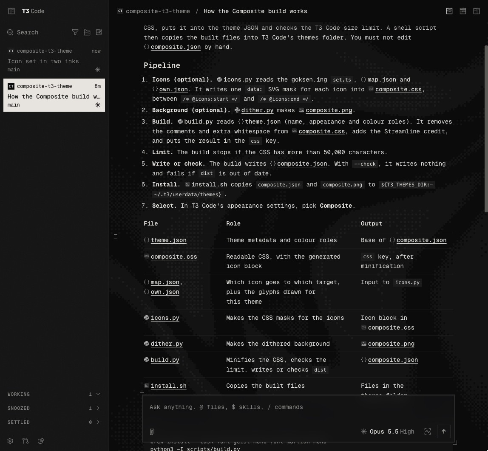
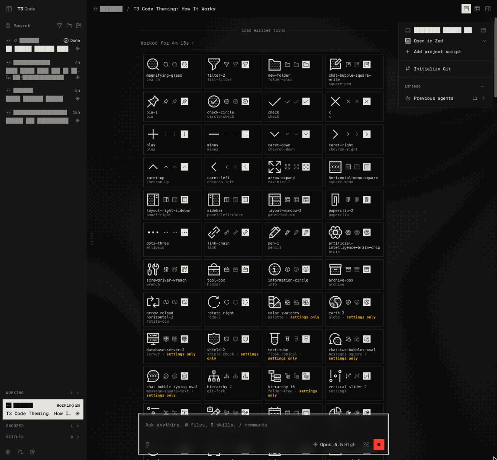
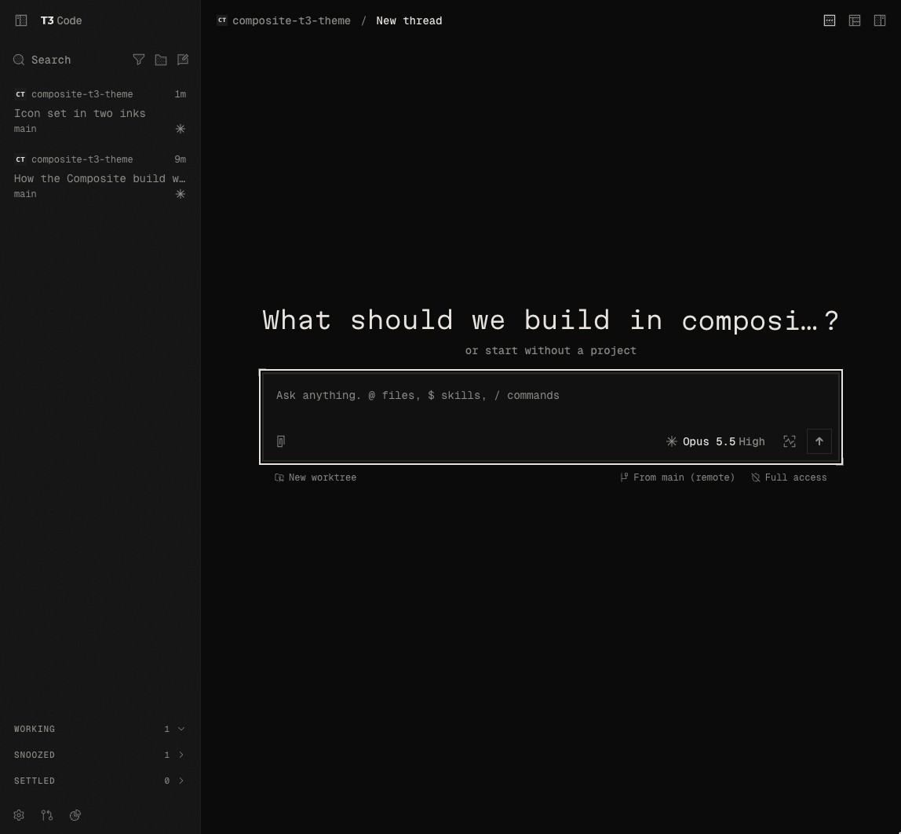
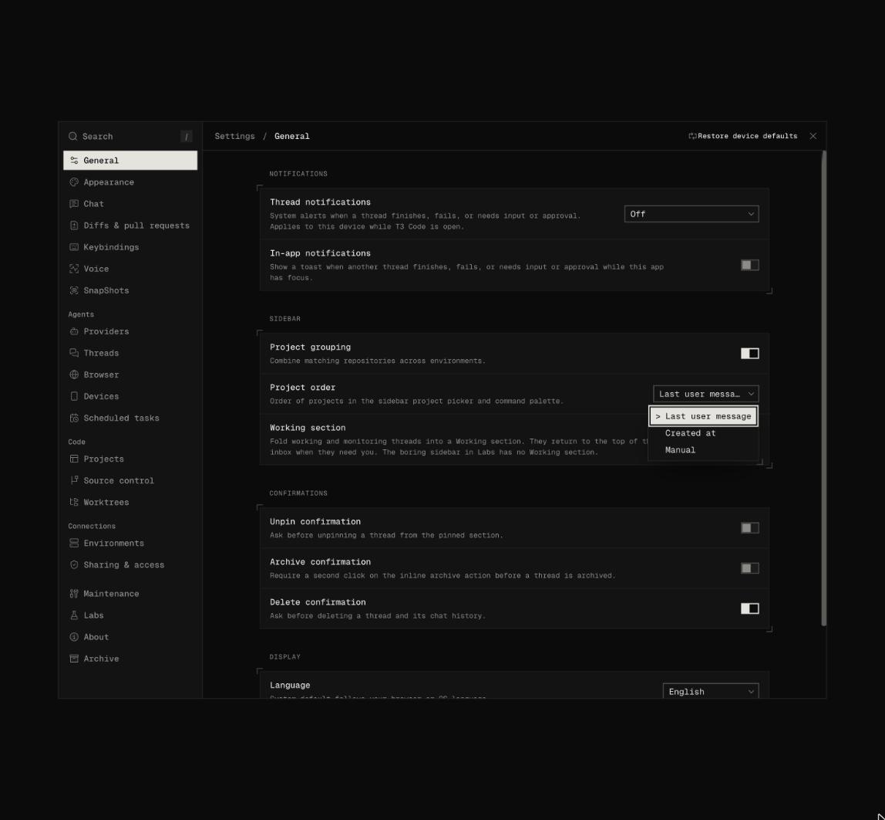
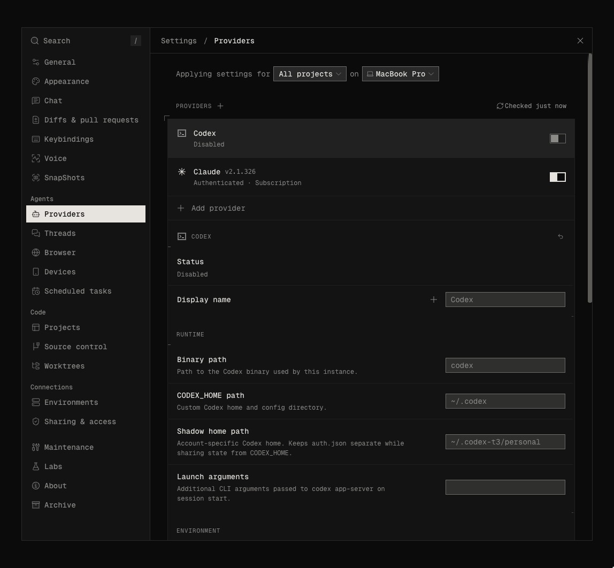

# Composite for T3 Code

A dark theme for [T3 Code](https://t3.codes) that applies Composite, the goksen.ing design system: bone on near-black, one red, square corners, 1 px rules, crop marks and steps-only motion.

Tested with T3 Code 0.1.10 (web and desktop). The theme is dark only.



| | |
|---|---|
|  |  |
|  |  |

The screenshots come from a real workspace. Project names, other thread titles and the machine name are redacted with block characters.

## What it changes

- **Colours.** The grey ladder (Ink, Card, Well, Rule, Mark, Edge, Muted Text) and bone. Signal red is only for the send and stop buttons and for errors. Warn amber is for warnings and for the busy mark. Tailwind's palette is folded into this ladder, so new parts of the app do not show blue or green.
- **Type.** Geist Mono everywhere, and Martian Mono (semi-wide, light) for the empty-thread title.
- **Shapes.** Square corners, no shadows, 1 px rules, and crop marks on the composer, settings groups and popups.
- **States.** A state is a solid fill, never an opacity change. The selected thread row inverts to bone. Switches show two cues.
- **Motion.** Every change is a hard cut with `steps()`. A busy indicator is an amber frame that blinks; a thread that needs you shows a solid amber square. Under reduced motion, every effect shows its final state.
- **Icons.** 43 icons from the goksen.ing Icon set (Streamline Sharp Duo Free, redrawn in two inks with an ordered dither), plus provider glyphs for Claude and Codex.
- **Background.** One dithered frame of a wave, in Ink, Card and Well, behind the chat.

## Install

Install the fonts first. On macOS:

```sh
brew install --cask font-geist-mono font-martian-mono
```

Then copy the theme into T3 Code's themes folder:

```sh
scripts/install.sh
```

Pick **Composite** in T3 Code's appearance settings. If the desktop app does not show the change, restart it.

### Install with an AI agent

Paste this prompt into a coding agent, for example a thread in T3 Code:

```text
Install the goksen.ing theme for T3 Code from
https://github.com/dopplerDistortion/composite-t3-theme

1. Clone the repo into a temporary folder, or pull it if I already have it.
2. Check if the fonts Geist Mono and Martian Mono are installed. If a font
   is missing, ask me before you install it. On macOS, the command is:
   brew install --cask font-geist-mono font-martian-mono
3. Run scripts/install.sh. It copies dist/composite.json and
   dist/composite.png into T3 Code's themes folder
   (default: ~/.t3/userdata/themes).
4. If you have T3 Code's t3_theme_set tool, switch to the theme
   "composite" with the appearance "dark". If you do not have it, tell me
   to pick "Composite" in T3 Code's appearance settings.
5. Do not change other themes, and do not edit dist/composite.json.
6. Tell me what you did. If the desktop app does not show the theme, tell me
   to restart it.
```

## Change the theme

Edit the source, then build. Do not edit `dist/composite.json` by hand.

| File | What it holds |
|---|---|
| `src/composite.css` | The readable CSS. |
| `src/theme.json` | The theme name, appearance and colour roles. |
| `icons/map.json` | Which T3 Code icon gets which Icon set icon. A key is a Lucide name, or a raw attribute selector for a provider glyph. |
| `icons/own.json` | Glyphs drawn for this theme on the same 24-unit grid. |

```sh
python3 -I scripts/build.py           # write dist/composite.json
python3 -I scripts/build.py --check   # fail if dist is out of date
scripts/install.sh
```

T3 Code accepts at most 50,000 characters of theme CSS. The build minifies the CSS and fails when the result is too large. The theme now uses about 45,000.

### Icons

The icon block in `src/composite.css` is generated. It sits between `/* @icons:start */` and `/* @icons:end */`. To rebuild it from the goksen.ing repo:

```sh
python3 -I scripts/icons.py --set ../goksen.ing/src/lib/icons/set.ts
python3 -I scripts/build.py
```

A theme cannot change T3 Code's markup, so each icon is a CSS mask with a `data:` SVG. The line takes the part's text colour. The dither is the same colour at 42 %, which gives Edge grey on Ink.

### Background

```sh
python3 -I scripts/dither.py dist/composite.png 2560 1600 3.0 5 2 0b0b0c,0b0b0c,131314,131314,1c1c1d
```

The arguments are: output, width, height, time, levels, scale, and the palette from the darkest level to the brightest.

## Fragile selectors

T3 Code documents a short list of stable selectors. Some rules need more, such as Tailwind class names and status marks. These rules are in the block marked `FRAGILE` at the end of `src/composite.css`. Check that block after each T3 Code update. If a rule stops matching, that part shows T3 Code's default style again; nothing breaks.

## Credits

- Icons: [Streamline](https://www.streamlinehq.com) Sharp Duo Free, CC BY 4.0. See `NOTICE`.
- Fonts: Geist Mono (Vercel) and Martian Mono (Evil Martians), both under the SIL Open Font License. They are not bundled.
